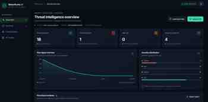
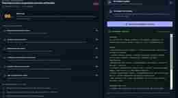

<!--
  BreachLens AI — Explainable Security Intelligence
  Keep setup and capability claims aligned with the current MVP.
-->

<div align="center">

# 🛡️ BreachLens AI

### Turn security-event noise into explainable investigations.

**An AI-assisted cybersecurity triage dashboard that correlates security logs, surfaces suspicious patterns, and gives analysts evidence-backed next steps.**

<br/>


[Launch the repository](https://github.com/Mohitrath/BreachLens-AI) · [Report an issue](https://github.com/Mohitrath/BreachLens-AI/issues)

</div>

---

## 🖼️ Application Screenshots

The following screenshots show the actual BreachLens AI interface: the security overview, prioritised incident investigation, and AI incident copilot output.

<p align="center">
  <strong>1. Security overview</strong><br/>
  
</p>

<p align="center">
  <strong>2. Prioritised incidents and investigation</strong><br/>
  
</p>

<p align="center">
  <strong>3. AI incident copilot assessment</strong><br/>
  
</p>

---

## ✨ What is BreachLens AI?

Security teams can receive thousands of disconnected events from identity providers, endpoints, cloud services, and file systems. Important signals are easy to miss when each event is viewed in isolation.

**BreachLens AI** is a defensive-security prototype built to help analysts review event data as a connected investigation. It normalises uploaded CSV logs, groups activity by user, applies transparent risk rules, explains which signals fired, and prioritises cases for human review. An optional Gemini-powered copilot turns the selected case into a concise investigation assessment; the app also works without an API key.

> **Design principle:** every risk score is a triage hint—not proof of compromise. Findings should be validated against trusted telemetry by an authorised analyst.

## 🚀 Highlights

| Capability | What it does |
|---|---|
| 📊 **SOC dashboard** | Summarises analysed events, observed accounts, and Critical / High / Medium / Low incident counts. |
| 🔎 **CSV ingestion** | Accepts security-event CSVs and normalises common aliases for timestamps, users, IP addresses, actions, resources, and byte counts. |
| 🧠 **Explainable detection** | Uses readable rules rather than opaque scores, so analysts can see why an identity was prioritised. |
| 🧩 **Event correlation** | Groups a user's uploaded events and highlights combinations that may deserve investigation. |
| 🗂️ **Investigation queue** | Filters and searches ranked incidents by identity, title, and severity. |
| 🕒 **Event timeline** | Shows relevant activity in chronological order for the selected case. |
| ✨ **AI investigation copilot** | Uses Gemini when configured, with a deterministic fallback when it is not. |
| 📤 **CSV report export** | Downloads a summary of the current incident queue for review and documentation. |
| 🔐 **Supabase authentication** | Email/password signup, login, password reset, server-verified sessions, protected dashboard/API routes, and logout. |

## 🧪 Signals the current rules look for

The baseline detection engine looks for combinations of signals such as:

- Repeated authentication failures.
- Access to resources whose names suggest sensitive content (for example, payroll, finance, credentials, or customer data).
- Repeated download, export, copy, or bulk-read actions.
- Privilege, token, or MFA-related events.
- Upload or exfiltration-like action labels.
- Activity involving multiple source IP addresses for the same user.
- High cumulative byte volume in the uploaded event set.

Rules contribute to a **heuristic score from 0 to 99**. Current severity bands are **Critical ≥ 85**, **High ≥ 65**, **Medium ≥ 40**, and **Low < 40**. These thresholds are configurable in code and are not calibrated probabilities or measured detection accuracy.

## 🖥️ Get started

### Requirements

- [Node.js](https://nodejs.org/) **20.9 or newer**
- npm
- A modern browser

### 1. Clone the repository

```bash
git clone https://github.com/Mohitrath/BreachLens-AI.git
cd BreachLens-AI
```

### 2. Install dependencies

```bash
npm install
```

### 3. Configure the environment

Copy the example file:

**Windows PowerShell**
```powershell
Copy-Item .env.example .env.local
```

**macOS / Linux**
```bash
cp .env.example .env.local
```

Supabase authentication is optional for the public hackathon demo. If Supabase variables are absent, the app opens in clearly labeled **public demo mode** so judges can explore without setup; this mode is not private and does not provide authentication. To enable real accounts, create a project at [Supabase](https://supabase.com), then copy the project URL and anon/public key into `.env.local` and your Vercel project environment settings. The Gemini key is optional. Leave it blank to use the built-in deterministic copilot response. Never commit actual credentials or `.env.local`.

### 4. Start the development server

```bash
npm run dev
```

Open **http://localhost:3000**. Without Supabase credentials, you can explore the public demo directly; this mode is for non-sensitive sample data only and is not access-controlled. With Supabase configured, create an account or sign in first; if email confirmation is enabled, confirm your email before signing in. After opening the dashboard, select **Load demo data** to populate it. You can also upload a CSV from your own test dataset.

### 5. Make a production build

```bash
npm run build
npm start
```

## 📥 CSV input format

BreachLens AI accepts a header row plus event rows. Column names can use common aliases; missing optional fields are filled with safe defaults.

| Canonical field | Example | Common aliases |
|---|---|---|
| `id` | `EVT-1001` | `event_id` |
| `timestamp` | `2026-10-14T08:01:12Z` | `time`, `datetime`, `event_time` |
| `user` | `a.sharma` | `username`, `account`, `actor` |
| `source_ip` | `203.0.113.20` | `ip`, `ip_address`, `src_ip` |
| `event_type` | `authentication` | `type`, `category` |
| `resource` | `finance/payroll.csv` | `file`, `target`, `object` |
| `action` | `download` | `operation`, `event` |
| `bytes` | `20000000` | `bytes_transferred`, `size_bytes` |
| `status` | `failed` | `result`, `outcome` |

### Example

Save the following as `sample-events.csv` and upload it in the UI:

```csv
id,timestamp,user,source_ip,event_type,resource,action,bytes,status
EVT-1,2026-10-14T08:01:12Z,alice,203.0.113.20,authentication,identity-provider,login_failed,0,failed
EVT-2,2026-10-14T08:02:12Z,alice,203.0.113.20,authentication,identity-provider,login_failed,0,failed
EVT-3,2026-10-14T08:03:12Z,alice,203.0.113.20,authentication,identity-provider,login_success,0,success
EVT-4,2026-10-14T08:04:12Z,alice,203.0.113.20,file_access,finance/payroll.csv,download,20000000,success
```

Use synthetic or sanitised logs for demonstrations. Do not upload production-sensitive data into an environment that has not been approved to handle it.

## 🧭 How it works

```text
Security-event CSV / built-in sample scenario
                    │
                    ▼
          Normalise common log fields
                    │
                    ▼
        Group events by user identity
                    │
                    ▼
     Apply explainable detection rules
                    │
                    ▼
       Score and rank candidate cases
                    │
                    ▼
 Dashboard · evidence · timeline · export
                    │
                    ▼
 Optional Gemini summary / safe fallback
                    │
                    ▼
        Human analyst validates findings
```

## 🤖 Optional Gemini copilot

Add your own Gemini API key to `.env.local`:

```env
GEMINI_API_KEY=your_key_here
GEMINI_MODEL=gemini-2.0-flash
```

Restart the development server after changing environment variables. Without a key, BreachLens AI uses a deterministic, evidence-based response instead of making an external model request.

**Privacy note:** sending logs to an external AI provider may disclose sensitive information. Use synthetic or sanitised events for demos, and obtain organisational approval before processing real security logs with a third-party model.

## 🔌 API endpoints

### `POST /api/analyze`

Load the built-in sample scenario:

```json
{ "mode": "sample" }
```

Or submit an event array:

```json
{
  "events": [
    {
      "timestamp": "2026-10-14T08:01:12Z",
      "user": "alice",
      "action": "login_failed",
      "event_type": "authentication",
      "resource": "identity-provider",
      "source_ip": "203.0.113.20"
    }
  ]
}
```

### `POST /api/copilot`

Submit the selected incident object for an evidence-oriented assessment:

```json
{
  "incident": {
    "user": "alice",
    "summary": "Review this account's activity",
    "findings": [],
    "recommendedActions": []
  }
}
```

## 🎬 Suggested 2-minute demo

1. Click **Load demo data** to populate the SOC dashboard.
2. Open the highest-ranked identity and show the severity and risk score.
3. Walk through the findings: failed logins, sensitive access, privilege indicators, or upload activity where present.
4. Explain how the findings refer to observable event patterns and why they need validation.
5. Generate the AI copilot assessment and review suggested next steps.
6. Export the incident summary as CSV.
7. Upload a small, clean CSV to demonstrate ingestion beyond the sample scenario.

## 🏗️ Tech stack

- **Next.js 15** — application framework and API routes
- **React 19 + TypeScript** — UI and typed event models
- **Recharts** — dashboard visualisations
- **Lucide React** — interface icons
- **Gemini API (optional)** — AI-assisted incident assessment

## 🔐 Authentication setup

1. Create a Supabase project and open **Project Settings → API**.
2. Copy the Project URL and anon/public key into `.env.local` as `NEXT_PUBLIC_SUPABASE_URL` and `NEXT_PUBLIC_SUPABASE_ANON_KEY`.
3. Add the same variables to Vercel under **Project → Settings → Environment Variables**, then redeploy.
4. In Supabase Authentication URL Configuration, set the Site URL to your deployed domain and add `http://localhost:3000/auth/callback` plus `https://YOUR-VERCEL-DOMAIN/auth/callback` to the allowed redirect URLs.
5. Use the login page to create an account, confirm the email if enabled, and sign in. Dashboard pages and `/api/*` endpoints require a valid Supabase session.

Use only the Supabase anon/public key in `NEXT_PUBLIC_SUPABASE_ANON_KEY`. **Never expose a Supabase service-role key in client code or a `NEXT_PUBLIC_*` variable.**

## 🔐 Security posture and current limitations

BreachLens AI is a **hackathon MVP / local demonstration**, not a production SIEM or incident-response platform.

- Supabase email/password authentication protects dashboard pages and API endpoints. This MVP still does not include role-based access control, multi-tenancy, or database persistence for incident records.
- No live SIEM/EDR/cloud audit connectors; events are loaded from a CSV or the built-in sample scenario.
- Correlation is currently performed per user over the uploaded dataset, rather than using bounded time windows and a full entity graph.
- Rule scores can create false positives and false negatives. They have not been calibrated or benchmarked against a labelled dataset.
- The dashboard's risk chart is a compact overview of observed incident scores, not a validated time-series anomaly detector.
- Copilot output is advisory and may be incomplete or incorrect. Confirm findings against trusted identity-provider, endpoint, cloud-audit, and network telemetry.
- No containment or disruptive action is performed automatically.

Before production use, add input/file limits, schema validation, bounded-window correlation, audit logging, authentication, RBAC, tenant isolation, retention controls, and a documented evaluation process.

## 🗺️ Roadmap

- [ ] Add time-window correlation and event deduplication.
- [ ] Add identity/device/IP entity relationships.
- [ ] Add source-specific parsers for identity, endpoint, cloud audit, and proxy logs.
- [ ] Add authenticated case management and auditable analyst decisions.
- [ ] Evaluate precision, recall, false-positive rate, and analyst time saved on labelled data.
- [ ] Design approval-gated response integrations.

## 🤝 Contributing

Issues and pull requests are welcome. For substantial changes, open an issue first to discuss the problem and proposed solution. Please do not include real secrets, customer data, or sensitive production logs in issues or pull requests.

## 📄 License

No license has been declared yet. Unless a license is added to this repository, standard copyright restrictions apply.

---

<div align="center">

**BreachLens AI — Explain the signal. Investigate the evidence. Keep humans in control.**

Built as a defensive cybersecurity prototype.

</div>
